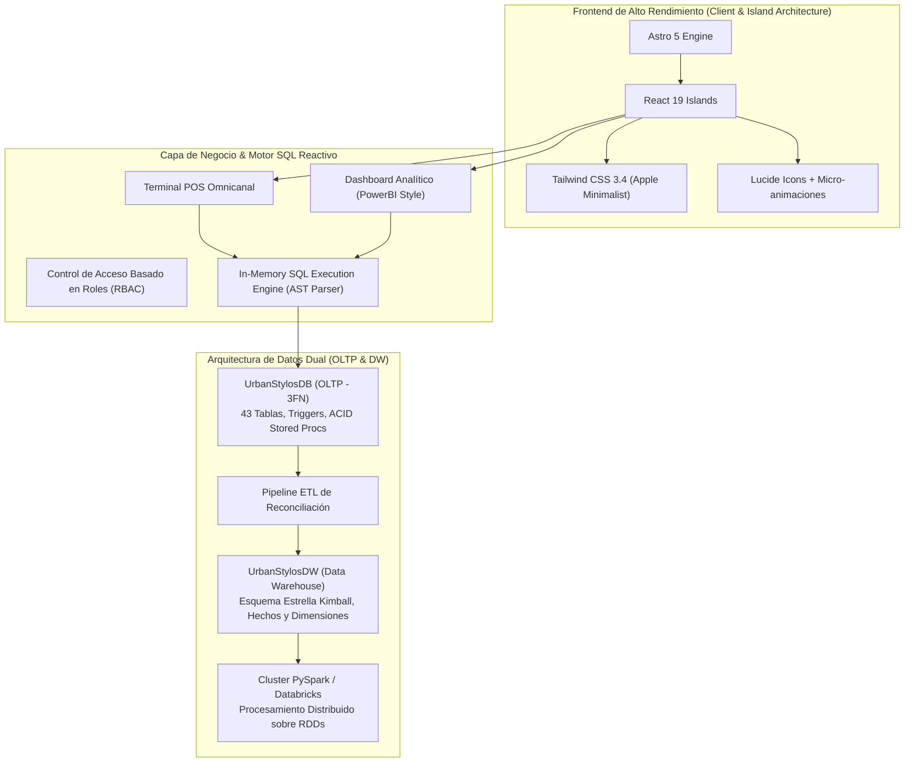
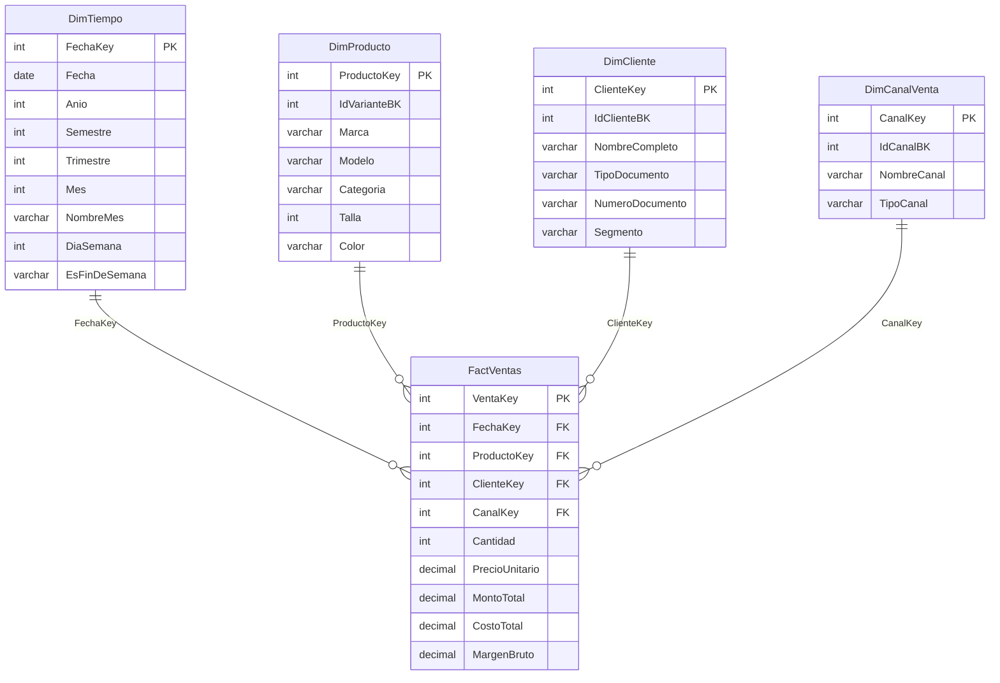

# URBAN STYLE — Enterprise Omnichannel POS & Analytical Intelligence

[](https://astro.build/)
[](https://react.dev/)
[](https://www.typescriptlang.org/)
[](https://tailwindcss.com/)
[](https://www.microsoft.com/sql-server)
[](https://spark.apache.org/)
[](LICENSE)

---

## 📑 Tabla de Contenidos
1. [Resumen Ejecutivo & Contexto de Negocio](#-resumen-ejecutivo--contexto-de-negocio)
2. [Arquitectura del Sistema & Stack Tecnológico](#-arquitectura-del-sistema--stack-tecnol%C3%B3gico)
3. [Matriz de Seguridad & Control de Accesos (RBAC)](#-matriz-de-seguridad--control-de-accesos-rbac)
4. [Diseño de Base de Datos Transaccional (OLTP en 3FN)](#-dise%C3%B1o-de-base-de-datos-transaccional-oltp-en-3fn)
5. [Data Warehouse Dimensional (Metodología Ralph Kimball)](#-data-warehouse-dimensional-metodolog%C3%ADa-ralph-kimball)
6. [Computación Distribuida & Big Data (PySpark)](#-computaci%C3%B3n-distribuida--big-data-pyspark)
7. [Motor SQL Reactivo en Memoria (In-Browser Execution)](#-motor-sql-reactivo-en-memoria-in-browser-execution)
8. [Diseño UI/UX — Apple Minimalist & Anti-Generic Standard](#-dise%C3%B1o-uiux--apple-minimalist--anti-generic-standard)
9. [Guía de Sustentación Universitaria para el Docente](#-gu%C3%ADa-de-sustentaci%C3%B3n-universitaria-para-el-docente)
10. [Estructura del Repositorio](#-estructura-del-repositorio)
11. [Instalación, Ejecución & Despliegue](#-instalaci%C3%B3n-ejecuci%C3%B3n--despliegue)
12. [Créditos & Autoría](#-cr%C3%A9ditos--autor%C3%ADa)

---

## 🏢 Resumen Ejecutivo & Contexto de Negocio

**Urban Style** (RUC: `10449598569`) es una empresa peruana especializada en la comercialización minorista y corporativa de calzado deportivo y urbano de alta gama (*Adidas, Nike, Puma, Reebok, New Balance, Vans, Converse*).

### Desafío Operativo
La empresa opera bajo un modelo **omnicanal** que integra:
- Puntos de Venta Físicos (POS en tienda).
- Canales Digitales Conversacionales (WhatsApp Store, Instagram Direct, TikTok Shop, Facebook Marketplace).
- Comercio Electrónico Web B2C.
- Ventas Corporativas B2B (empresas e instituciones).

Ante el crecimiento de las transacciones y la exigencia tributaria de la **SUNAT** (Resolución de Superintendencia para emisión electrónica de Boletas y Facturas), el sistema resuelve tres necesidades críticas:
1. **Consistencia Transaccional Estricta (ACID):** Evitar sobreventas y garantizar que las disminuciones de inventario y la emisión de comprobantes se ejecuten de manera atómica.
2. **Inteligencia de Negocios en Tiempo Real (OLAP):** Consolidar las transacciones operativas en un Data Warehouse dimensional para análisis de márgenes, rotación de calzado por talla/marca y rendimiento por canal de captación.
3. **Escalabilidad Analítica en Grandes Volúmenes:** Procesamiento masivo de logs y transacciones históricas mediante clústeres Spark con transformaciones RDD y DataFrames optimizados.

---

## ⚡ Arquitectura del Sistema & Stack Tecnológico

El proyecto implementa una arquitectura híbrida de alto rendimiento:



### Tecnologías Empleadas
- **Framework Núcleo:** [Astro 5](https://astro.build/) (Renderizado estático ultrarrápido con arquitectura de islas).
- **Capa Interactiva:** [React 19](https://react.dev/) (Hooks avanzados, estado reactivo sincronizado).
- **Tipado & Calidad:** [TypeScript 5.7](https://www.typescriptlang.org/) (Tipado estricto, 0 errores en compilación).
- **Diseño & Estilos:** [Tailwind CSS 3.4](https://tailwindcss.com/) + CSS Glassmorphism de alta densidad (`backdrop-blur-2xl`).
- **Persistencia & Scripts:** SQL Server Transact-SQL (T-SQL) scripts nativos en `sql/` + PySpark 3.5 en Google Colab.

---

## 🔐 Matriz de Seguridad & Control de Accesos (RBAC)

El sistema cuenta con autenticación y autorización basada en roles (RBAC) con dos perfiles claramente diferenciados:

| Perfil / Rol | Correo Electrónico | Contraseña | Permisos y Alcance Operativo |
| :--- | :--- | :--- | :--- |
| **Gerencia General** | `gerencia@urbanstyle.pe` | `admin123` | **Acceso Total (Full Admin):**<br/>• Dashboard Analítico PowerBI (Ventas, Márgenes, Canales, Horas pico).<br/>• Terminal POS / Catálogo de Calzado.<br/>• Consola de Ejecución de Scripts Académicos (OLTP / DW / PySpark).<br/>• Auditoría Transaccional y Reconciliación ETL.<br/>• Ajustes de Stock y Parámetros del Sistema. |
| **Personal de Ventas** | `ventas@urbanstyle.pe` | `ventas123` | **Acceso Operativo Restringido:**<br/>• Acceso exclusivo al Catálogo y Venta POS.<br/>• Emisión de Boletas/Facturas a clientes.<br/>• **Bloqueo de Dashboard:** Si intenta acceder, el sistema genera una alerta visual de seguridad.<br/>• **Ocultación de Scripts:** Los modales de DDL/DML y consultas analíticas permanecen inaccesibles para evitar fugas de información. |

---

## 🗄️ Diseño de Base de Datos Transaccional (OLTP en 3FN)

La base de datos operativa **`UrbanStylosDB`** ha sido diseñada bajo estrictos estándares de la **Tercera Forma Normal (3FN)**, eliminando redundancias y anomalías de inserción, actualización y borrado.

### Estructura de Scripts
Todos los scripts están organizados y ejecutables en la carpeta [`sql/`](file:///home/jeffryjara/Documentos/Web/urbanstyle/sql/):
- [`sql/01_UrbanStylosDB_OLTP.sql`](file:///home/jeffryjara/Documentos/Web/urbanstyle/sql/01_UrbanStylosDB_OLTP.sql): Creación de esquema transaccional, 43 tablas, catálogos SUNAT, triggers y stored procedures.
- [`sql/03_Datos_Prueba_DML.sql`](file:///home/jeffryjara/Documentos/Web/urbanstyle/sql/03_Datos_Prueba_DML.sql): Población masiva de datos y pruebas de carga transaccional.

### Justificación de Normalización (1FN, 2FN, 3FN)
1. **Primera Forma Normal (1FN):**
   - Atributos indivisibles (atómicos): nombres de clientes separados, teléfonos individuales, direcciones estandarizadas por Ubigeo.
   - Existencia de clave primaria única en cada entidad (`IDENTITY(1,1)` o clave compuesta explícita).
2. **Segunda Forma Normal (2FN):**
   - Se eliminaron las dependencias funcionales parciales. En la tabla de detalle `DetalleVenta (IdVenta, IdVarianteProducto)`, atributos como el `PrecioUnitarioHistorico` dependen de toda la clave compuesta de la venta, mientras que la información descriptiva del producto reside en su tabla maestra.
3. **Tercera Forma Normal (3FN):**
   - Desacoplamiento de dependencias transitivas: `VarianteProducto` enlaza con `Modelo`, `Modelo` con `Marca`, y `Distrito` con `Provincia` y `Departamento`. No existen campos derivados ni atributos descriptivos en cascada dentro de tablas transaccionales.

### Garantía ACID: Procedimiento Almacenado `sp_RegistrarVenta`
El procedimiento almacenado [`sp_RegistrarVenta`](file:///home/jeffryjara/Documentos/Web/urbanstyle/src/data/sqlPresets.ts#L60-L75) implementa transacciones explícitas con control de concurrencia:
```sql
BEGIN TRANSACTION;
BEGIN TRY
    -- 1. Validación estricta de stock disponible
    IF (SELECT Stock FROM VarianteProducto WHERE IdVariante = @IdVariante) < @Cantidad
    BEGIN
        RAISERROR('Stock insuficiente para concretar la venta.', 16, 1);
    END;

    -- 2. Descuento atómico de inventario
    UPDATE VarianteProducto 
    SET Stock = Stock - @Cantidad 
    WHERE IdVariante = @IdVariante;

    -- 3. Inserción de cabecera y detalle de comprobante
    INSERT INTO Venta (IdCliente, IdCanalVenta, IdTipoComprobante, FechaEmision)
    VALUES (@IdCliente, @IdCanalVenta, @IdTipoComprobante, SYSDATETIME());
    
    SET @IdVenta = SCOPE_IDENTITY();

    INSERT INTO DetalleVenta (IdVenta, IdVarianteProducto, Cantidad, PrecioUnitario)
    VALUES (@IdVenta, @IdVariante, @Cantidad, @PrecioUnitario);

    COMMIT TRANSACTION;
END TRY
BEGIN CATCH
    -- Reversión total ante cualquier falla
    ROLLBACK TRANSACTION;
    THROW;
END CATCH;
```

### Triggers de Integridad & Auditoría
- **`trg_auditoria_ventas`:** Registra cualquier intento de modificación sobre tablas tributarias, salvaguardando la inmutabilidad fiscal.
- **`trg_control_stock`:** Intercepta operaciones DML a nivel de fila asegurando que ningún calzado alcance stock negativo por condiciones de carrera (*race conditions*).

---

## 📊 Data Warehouse Dimensional (Metodología Ralph Kimball)

Para el análisis histórico y toma de decisiones, se diseñó la base de datos **`UrbanStylosDW`** siguiendo el enfoque dimensional de **Ralph Kimball**.

### Archivos de Referencia
- [`sql/02_UrbanStylosDW_Kimball.sql`](file:///home/jeffryjara/Documentos/Web/urbanstyle/sql/02_UrbanStylosDW_Kimball.sql): Definición de dimensiones, tabla de hechos `FactVentas` y vistas materializadas.
- [`sql/04_Pruebas_OLAP_Reconciliacion.sql`](file:///home/jeffryjara/Documentos/Web/urbanstyle/sql/04_Pruebas_OLAP_Reconciliacion.sql): Consultas analíticas multidimensionales (ROLLUP, CUBE, Window Functions) y validación de reconciliación.

### Arquitectura Dimensional en Estrella (Star Schema)


### Granularidad de la Tabla de Hechos (`FactVentas`)
- **Nivel de detalle atómico:** Cada fila representa exactamente **una línea de detalle de comprobante emitido**.
- **Métricas aditivas:** `Cantidad`, `MontoTotal`, `CostoTotal`, `MargenBruto` (S/ total - Costo total).
- **Manejo de Variaciones:** Dimensión `DimProducto` con preparación para **SCD Tipo 2 (Slowly Changing Dimensions)** con claves sustitutas (*Surrogate Keys*) y atributos de vigencia temporal.

---

## 🚀 Computación Distribuida & Big Data (PySpark)

En entornos de alto volumen transaccional, el procesamiento analítico se delega a clústeres distribuidos utilizando **Apache Spark (PySpark)**.

- **Archivo Oficial:** [`sql/05_PySpark_Cluster_RDD.py`](file:///home/jeffryjara/Documentos/Web/urbanstyle/sql/05_PySpark_Cluster_RDD.py).
- **Entorno de Ejecución:** Compatible con Google Colab, Databricks y clústeres locales Spark 3.5+.

### Conceptos Demostrados
1. **Configuración Óptima del Driver & Cluster:**
   ```python
   spark = (
       SparkSession.builder
       .master("local[*]")
       .appName("UrbanStyle-BigData-Analytics")
       .config("spark.sql.shuffle.partitions", "8")
       .getOrCreate()
   )
   ```
2. **Transformaciones Estrechas vs Anchas (Narrow vs Wide Dependencies):**
   - **Narrow:** `map()`, `filter()` (sin movimiento de datos entre nodos).
   - **Wide:** `reduceByKey()`, `groupByKey()` (requiere etapa de *shuffle* distribuido a través de la red).
3. **Casos de Uso Implementados:**
   - Cálculo distribuido del calzado de mayor rotación por canal.
   - Detección de patrones de compra anómalos y clientes de alto valor (*Pareto 80/20*).

---

## ⚙️ Motor SQL Reactivo en Memoria (In-Browser Execution)

El repositorio incluye un motor relacional en memoria desarrollado en TypeScript [`src/utils/sqlEngine.ts`](file:///home/jeffryjara/Documentos/Web/urbanstyle/src/utils/sqlEngine.ts) que permite al usuario y docente interactuar en tiempo real con las sentencias SQL desde el propio navegador web sin requerir un servidor SQL Server físico conectado en el instante de la demo.

### Capacidades del Motor
- **Parser de Consultas:** Soporte para `SELECT`, `WHERE`, `ORDER BY`, `GROUP BY`, `JOIN`, `LIMIT`.
- **Transacciones ACID Simuladas:** Validación de inventario, detección de stock agotado y emisión de excepciones antes de confirmar cambios en memoria.
- **Sincronización Bidireccional:** Cualquier compra realizada en el Terminal POS impacta instantáneamente las tablas de auditoría y los gráficos del Dashboard.

---

## 🎨 Diseño UI/UX — Apple Minimalist & Anti-Generic Standard

El diseño de la aplicación ha sido concebido para erradicar cualquier estética genérica o típica de plantillas convencionales:

- **Paleta Cromática Monocromática Pura:** Base en `#000000`, tarjetas en superficie `#1C1C1E`, separadores en `#2C2C2E`, tipografía editorial de alto contraste en `#FFFFFF` y secundario `#8E8E93`.
- **Acento Estratégico:** Color azul sólido de precisión (`#007AFF`) reservado para acciones de alta prioridad y confirmaciones.
- **Notificaciones Tipo Píldora (Apple Toast):**
  - Ubicación centrada superior con desenfoque ultra-denso (`backdrop-blur-2xl` + opacidad de vidrio al 95%).
  - Contador dinámico de acumulación (`×2`, `×3`, etc.) para evitar spam visual cuando el usuario interactúa repetidamente.
  - Alertas semánticas con iconos específicos: éxito (azul/verde), advertencia de límite de stock (ámbar), restricción de seguridad (rojo).
- **Física de Animaciones Fluida:** Micro-rebotes inspirados en iOS al abrir modales, cambiar de sección (`top-to-bottom bounce`), y cierre rápido con tecla `Esc`.
- **100% Responsivo:** Segmented controls nativos en dispositivos móviles, barra de checkout flotante y tablas analíticas con desplazamiento táctil asistido.

---

## 🎓 Guía de Sustentación Universitaria para el Docente

Esta sección proporciona las respuestas fundamentadas a las preguntas más rigurosas que un jurado o docente universitario suele realizar durante la defensa de proyectos de Bases de Datos y Business Intelligence:

### 1. ¿Por qué se utilizó una base de datos 3FN para las ventas y un esquema en estrella para el Dashboard?
> **Respuesta Técnica:**
> Las bases de datos transaccionales (OLTP) priorizan la **velocidad de escritura, la integridad referencial y la eliminación de anomalías de actualización** mediante la normalización en 3FN. Consultar un sistema OLTP directamente para analítica pesada generaría bloqueos de tablas (*table locks*) y degradaría la operación en caja.
> 
> Por ello, se diseña un **Data Warehouse (OLAP)** con esquema en estrella según la metodología de Ralph Kimball. Al desnormalizar controladamente las dimensiones y precalcular agregaciones en la tabla de hechos, las consultas analíticas reducen drásticamente la cantidad de `JOINs`, permitiendo agregaciones instantáneas sin afectar la operación diaria.

### 2. ¿Cómo se garantiza la propiedad de Aislamiento (Isolation) en las ventas concurrentes?
> **Respuesta Técnica:**
> En SQL Server se configura el nivel de aislamiento adecuado (`SNAPSHOT` o `READ COMMITTED SNAPSHOT`) y se emplean bloqueos pesimistas u optimistas según la demanda. En el procedimiento `sp_RegistrarVenta`, el bloqueo se realiza a nivel de fila sobre `VarianteProducto` mediante `UPDLOCK`, evitando que dos cajeros simultáneos vendan el último par de calzado en stock.

### 3. ¿Cuál es la diferencia entre una Vista Normal y una Vista Indexada (Materializada)?
> **Respuesta Técnica:**
> Una vista estándar (`CREATE VIEW`) es únicamente una consulta almacenada que se ejecuta dinámicamente cada vez que es invocada. Una **Vista Indexada (Indexed View)** en SQL Server crea un índice clustered único sobre la vista, guardando físicamente el resultado en disco. Esto acelera lecturas masivas con el costo de mantenimiento en cada inserción sobre las tablas base.

### 4. ¿Por qué usar Apache Spark (PySpark) en lugar de consultas SQL tradicionales cuando los datos crecen?
> **Respuesta Técnica:**
> Los motores de bases de datos relacionales convencionales están limitados al escalamiento vertical (añadir más CPU y RAM a un único servidor). Cuando el volumen de datos alcanza terabytes o petabytes con millones de interacciones omnicanal, **Apache Spark ofrece escalamiento horizontal distribuido**, particionando los datos a través de nodos de cómputo en clúster y ejecutando transformaciones en memoria mediante RDDs con tolerancia a fallos basada en linaje (*lineage graph*).

---

## 📂 Estructura del Repositorio

```text
urbanstyle/
├── public/                     # Recursos públicos estáticos, logos y favicons
├── sql/                        # SCRIPTS OFICIALES DE BASE DE DATOS & BIG DATA
│   ├── 01_UrbanStylosDB_OLTP.sql              # DDL/DML Base de datos relacional 3FN (43 tablas)
│   ├── 02_UrbanStylosDW_Kimball.sql           # DDL/DML Data Warehouse Dimensional Kimball
│   ├── 03_Datos_Prueba_DML.sql                # Población masiva y simulación de transacciones
│   ├── 04_Pruebas_OLAP_Reconciliacion.sql     # Consultas OLAP, Window Functions y Auditoría
│   └── 05_PySpark_Cluster_RDD.py              # Script Big Data distribuido para Google Colab
├── src/
│   ├── components/             # Componentes React 19 de alta fidelidad
│   │   ├── layout/             # Sidebar navegable y Navbar con perfil activo
│   │   ├── ui/                 # Modales (Script, Stock, Comprobantes, Toast de notificaciones)
│   │   ├── App.tsx             # Orquestador principal de estado y sesión
│   │   ├── Dashboard.tsx       # Tablero analítico PowerBI-style con métricas y gráficas
│   │   ├── Login.tsx           # Pantalla de acceso seguro con RBAC
│   │   └── Pos.tsx             # Terminal POS de catálogo y registro de ventas
│   ├── data/                   # Semillas de datos, catálogos y presets de sentencias SQL
│   ├── layouts/                # Plantilla base Astro
│   ├── pages/                  # Rutas principales de la aplicación
│   ├── styles/                 # Configuración de estilos globales y keyframes de animación
│   ├── types/                  # Definiciones e interfaces TypeScript estrictas
│   └── utils/                  # Motor de ejecución SQL reactivo en navegador
├── astro.config.mjs            # Configuración de Astro e integraciones
├── package.json                # Dependencias, scripts y metadatos del proyecto
├── tailwind.config.mjs         # Configuración del sistema de diseño Tailwind CSS
└── tsconfig.json               # Configuración del compilador TypeScript
```

---

## 🛠️ Instalación, Ejecución & Despliegue

### Requisitos Previos
- **Node.js:** Versión `20.x` o superior.
- **Gestor de Paquetes:** [pnpm](https://pnpm.io/) (recomendado) o npm.
- **Base de Datos (Opcional para pruebas externas):** SQL Server 2019/2022 o Azure SQL Edge.

### Pasos de Instalación

1. **Clonar el repositorio:**
   ```bash
   git clone https://github.com/jeffryjara/urbanstyle.git
   cd urbanstyle
   ```

2. **Instalar dependencias:**
   ```bash
   pnpm install
   ```

3. **Verificación de tipos TypeScript:**
   ```bash
   pnpm check
   ```

4. **Iniciar entorno de desarrollo:**
   ```bash
   pnpm dev
   ```
   *La aplicación estará disponible de inmediato en `http://localhost:4321`.*

5. **Compilación para producción:**
   ```bash
   pnpm build
   pnpm preview
   ```

---

## 👨‍💻 Créditos & Autoría

- **Desarrollador / Alumno:** Jeffry Jara
- **Proyecto:** Urban Style Omnichannel Footwear & Analytical Platform
- **Propósito:** Demostración universitaria integral de Arquitectura de Bases de Datos Transaccionales (OLTP 3FN), Data Warehousing (Kimball) y Big Data Analytics con PySpark.
- **Licencia:** Distribuido bajo la Licencia MIT. Consulte el archivo `LICENSE` para más detalles.
